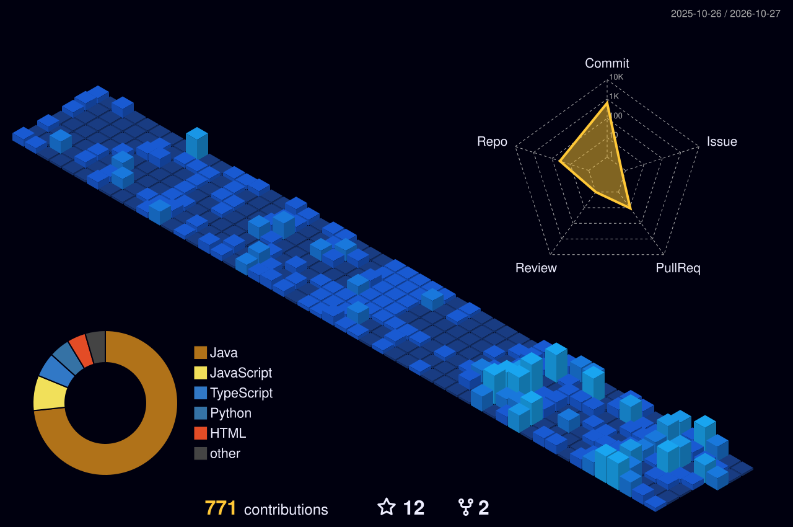

<table><tr><td width="27%" align="center" valign="middle"> <strong>B.Tech CSE Student · 2027</strong> Aditya University</td><td width="73%" valign="middle"></td></tr></table>

  

  

  

  

## 🚀 Featured builds

| Project | What it does | Stack |
|:---|:---|:---|
| [**SentinelAI**](https://github.com/ChandanLabs/SentinelAI) | Security monitoring with rule-based detection and Isolation Forest anomaly scoring | Next.js · TypeScript · Spring Boot · FastAPI · PostgreSQL · Docker |
| [**CampusGPT**](https://github.com/ChandanLabs/CampusGPT) | AI-powered learning assistant for academic Q&A and document understanding | Python · FastAPI · React · Gemini API |
| [**PlacementPulse**](https://github.com/ChandanLabs/PlacementPulse) | Placement workflow automation, student status tracking and Telegram follow-ups | Python · FastAPI · SQLAlchemy · Next.js |
| [**Building AI Agents**](https://github.com/ChandanLabs/Building-AI-agents) | Practical exploration of tool use, memory, RAG, planning and agent evaluation | Python · JavaScript · Gemini API · OpenAI API |
| [**SubmitReady**](https://github.com/ChandanLabs/submitready-aws) | Pre-submission validation workflow for application and scholarship packets | Node.js · AWS SAM · Lambda |

## 👨‍💻 About me

I'm a **B.Tech Computer Science & Engineering student at Aditya University**, graduating in **2027**, focused on backend engineering and AI-enabled software.

- Building backend services, REST APIs, database-backed applications and AI integrations.
- Learning cloud and DevOps workflows through hands-on projects.
- Practising data structures, algorithms and core computer science fundamentals.
- Interested in software engineering and AI engineering internship opportunities.

## 🧰 Technology orbit

**Languages:** Java · JavaScript · Python · TypeScript  
**Backend:** Node.js · Express.js · Spring Boot · FastAPI · REST APIs  
**Frontend:** React · Next.js · HTML · CSS  
**AI/ML:** Generative AI · Gemini API · OpenAI API · AI agents · anomaly detection  
**Data:** PostgreSQL · MySQL · MongoDB  
**Engineering tools:** IntelliJ IDEA · VS Code · Git · GitHub · GitHub Actions · QA testing  
**Infrastructure:** Docker · Linux · Kubernetes *(currently learning)*

The animated orbit above highlights these tools; its motion is created with SVG animation, not a video or a generated replacement portrait.

## 💼 Experience

**Web Development Intern — SkillDzire Technologies, Hyderabad**  
*May 2025 – June 2025*

Worked on web development features, API integration, database-backed functionality, debugging and Git-based development workflows.

## 🎓 Education

**B.Tech — Computer Science & Engineering**  
Aditya University, India · **2023–2027**

## 🌃 Contribution city

*The city regenerates through GitHub Actions.*

## 🤝 Connect

 

**Building systems. Learning deeply. Shipping in public.**

