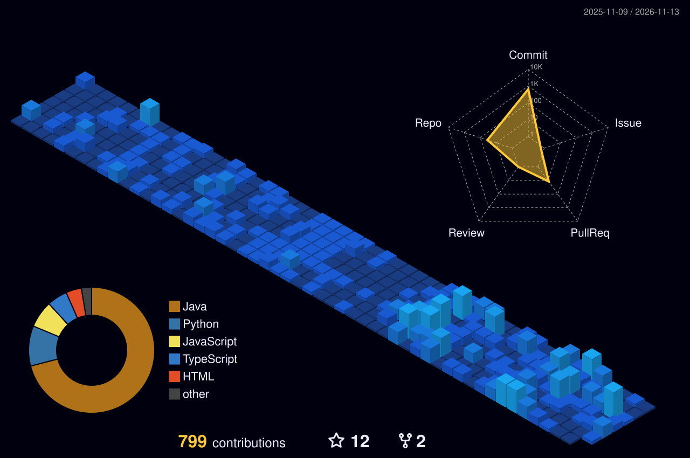

<table><tr><td width="27%" align="center" valign="middle"> <strong>B.Tech CSE · 2027</strong> Java-first · Aditya University</td><td width="73%" valign="middle"></td></tr></table>

  

  

  

  

## 🚀 Featured builds

| Project | What it does | Stack |
|:---|:---|:---|
| [**SentinelAI**](https://github.com/ChandanLabs/SentinelAI) | Security monitoring with rule-based detection and Isolation Forest anomaly scoring | Next.js · TypeScript · Spring Boot · FastAPI · PostgreSQL · Docker |
| [**CampusGPT**](https://github.com/ChandanLabs/CampusGPT) | AI-powered learning assistant for academic Q&A and document understanding | Python · FastAPI · React · Gemini API |
| [**PlacementPulse**](https://github.com/ChandanLabs/PlacementPulse) | Placement workflow automation, student status tracking and Telegram follow-ups | Python · FastAPI · SQLAlchemy · Next.js |
| [**Building AI Agents**](https://github.com/ChandanLabs/Building-AI-agents) | Practical exploration of tool use, memory, RAG, planning and agent evaluation | Python · JavaScript · Gemini API · OpenAI API |
| [**SubmitReady**](https://github.com/ChandanLabs/submitready-aws) | Pre-submission validation workflow for application and scholarship packets | Node.js · AWS SAM · Lambda |

## 🧪 Testing & Automation Activity

This section is refreshed automatically from testing-related commits detected in my **public GitHub activity**. Entries link to their source commits.

<!-- TESTING-ACTIVITY:START -->

<em>No recent public testing-focused commits detected yet. As I push test-related work to public repositories, this section will update automatically.</em>

<!-- TESTING-ACTIVITY:END -->

## 👨‍💻 About me

I'm a **B.Tech Computer Science & Engineering student at Aditya University**, graduating in **2027**, focused on **Java, backend development and software quality**. I'm a **fast learner** who enjoys learning by building, taking feedback and improving through consistent practice. I'm currently **upskilling in software automation testing**, with Java as my primary programming language.

- Strengthening Core Java, OOP, Collections, Streams, exception handling and problem-solving fundamentals.
- Currently upskilling in software automation testing, with a learning focus on Selenium WebDriver, Playwright, TestNG, Cucumber, REST Assured and Postman.
- Exploring test design, execution, debugging, Maven, JIRA/Xray, Git, CI/CD, SQL and Linux workflows.
- Building backend services and API-driven applications while continuously learning through hands-on projects.

## 🧰 Technology orbit

**Primary language:** **Java** · OOP · Collections · Streams · Lambda expressions · Exception handling · Java I/O  
**Backend & APIs:** Spring Boot · Node.js · Express.js · FastAPI · REST APIs  
**Software automation testing — currently upskilling:** Selenium WebDriver · Playwright · TestNG · Cucumber · REST Assured · Postman  
**Build & test tools:** Maven · JIRA · Xray · Git · GitHub Actions  
**Data:** MySQL · MongoDB · PostgreSQL · SQL  
**Cloud & systems:** Jenkins · Docker · Linux · AWS fundamentals · Kubernetes *(learning)*  
**AI tools:** Gemini · Claude · AI-assisted development

Java is the centre of the technology orbit; the surrounding languages, frameworks and testing tools represent areas I use or am actively learning. The orbit is animated with SVG.

## 💼 Experience

**Web Development Intern — SkillDzire Technologies, Hyderabad**  
*May 2025 – June 2025*

Worked on web development features, API integration, database-backed functionality, debugging and Git-based development workflows.

## 🎓 Education

**B.Tech — Computer Science & Engineering**  
Aditya University, India · **2023–2027**

## 🌃 Contribution city

*The city regenerates through GitHub Actions.*

## 🤝 Connect

 

**Java-first. Quality-minded. A fast learner, always building and improving.**

